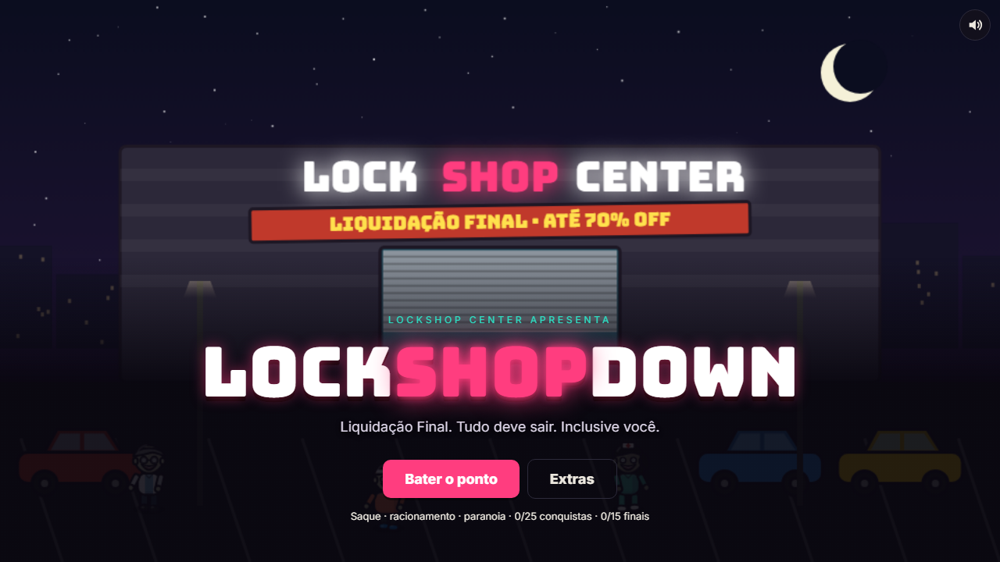

# LockShopDown

**Liquidação Final. Tudo deve sair. Inclusive você.**



Sexta-feira, 21h47. O LockShop Center está a minutos de fechar quando os alto-falantes anunciam uma "emergência sanitária". Lá fora se espalha **A Calma**: os infectados não gritam nem correm. Ficam tranquilos, simpáticos e prestativos. E começam a abraçar. Por muito tempo.

Um jogo de saque, racionamento e paranoia, com humor ácido e terror, feito em HTML, CSS e JavaScript puros, sem dependências.

## Baixar e jogar (Windows)

1. Baixe o **`LockShopDown-PC.zip`** na página de [Releases](../../releases/latest).
2. Extraia o ZIP inteiro numa pasta.
3. Dê dois cliques em **`LockShopDown.exe`**.

Funciona sem internet. Se o Windows mostrar *"O Windows protegeu o computador"*, clique em **Mais informações** e depois em **Executar assim mesmo** (o executável não é assinado).

Também dá pra jogar em qualquer sistema abrindo `LockShopDown/index.html` num navegador moderno.

## Como funciona

**Fase 1 · O saque.** De 2 a 4 minutos, conforme a dificuldade, para revistar prateleiras pelo shopping, resgatar sobreviventes e voltar ao Depósito 3B antes das portas de aço baixarem. Algumas lojas fecham antes, e quem ficar dentro fica preso. Cuidado com os clientes sorridentes.

**Fase 2 · O depósito.** Racione comida e água, mande expedições, decida quem entra pela porta (com perguntas e testes pelo olho mágico) e descubra quem do grupo está com A Calma antes que seja tarde.

- 4 dificuldades: Tranquilo, Normal, Pânico e Pesadelo
- 2 modos: Clássico e **Direto pro Depósito** (sem saque, começa com itens e pessoas aleatórias)
- 24 personagens, 21 itens, 45 eventos e 34 cutscenes
- 15 finais, 25 conquistas e 15 documentos de história para colecionar

## Controles

| Fase | Controle |
|---|---|
| Saque | `WASD` / setas para andar, `Shift` para correr, `E` para revistar, `Enter` para baixar a porta, ou clique no mapa |
| Depósito | Mouse: clique nas pessoas, na porta, na estante e no diário |
| Cutscenes | Clique, `Espaço` ou `Enter` avança. `Esc` pula |

## Estrutura

```
LockShopDown/        o jogo (abra o index.html)
  js/                core, arte, dados, saque, abrigo, cutscenes, progresso
  css/               estilos
  fonts/             fontes embutidas (funciona offline)
launcher/            inicializador do Windows (C#) e script de build
docs/                imagens do README
```

## Gerar a versão para PC

No Windows, sem instalar nada além do que já vem no sistema:

```
powershell -ExecutionPolicy Bypass -File launcher\build.ps1
```

Isso compila o `LockShopDown.exe` (com o compilador C# do .NET Framework) e gera `LockShopDown-PC.zip`.

## Créditos

Fontes: Bungee, Courier Prime, Inter, Patrick Hand e Permanent Marker, sob a [SIL Open Font License](https://openfontlicense.org).
